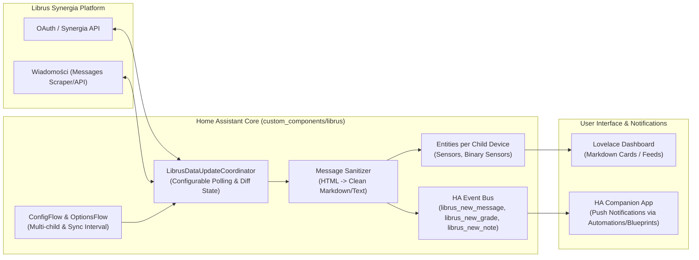

# Home Assistant Librus Synergia Integration — Project Plan & Tasks

> [!NOTE]
> In Home Assistant terminology, extensions can be built as a **Custom Integration** (`custom_components/librus/`), a **Supervisor Add-on** (standalone Docker container communicating via MQTT/REST), or an **AppDaemon App**.
> This plan recommends and details a **Native Custom Integration (`custom_components/librus`)** because it natively supports multi-account UI configuration (`ConfigFlow`), Device Registry grouping per child, native entities, and direct Event Bus firing for push notifications without requiring an external broker like MQTT.

---

## 1. Architecture Overview



### Core Design Pillars
1. **Multi-Child Support**:
   - Each child (student account) is configured either as a separate Config Entry or as sub-accounts under a single integration, mapped to a dedicated **Home Assistant Device** (e.g., `Librus - [Student Name]`).
   - All entities for a child are grouped under their respective Device and prefixed with the child's name/slug.
2. **Readable Incoming Messages**:
   - Librus messages often contain messy HTML, inline styles, or broken line breaks.
   - A dedicated **Message Sanitizer & Formatter** converts HTML bodies into clean, structured **Markdown** and plain text (preserving links, sender metadata, timestamp, and attachment indicators) ready for Lovelace Markdown cards and push notification payloads.
   - Because Home Assistant entity states are limited to `255` characters, full message contents are stored in **entity state attributes** (`messages_list`, `latest_message_body`, `latest_message_sender`, `latest_message_subject`) and emitted in **Event Bus payloads**.
3. **Grades & Notes Tracking**:
   - **Grades**: Tracks latest grade(s), recent grades feed (last $N$ grades with subject, value, weight, category, teacher, date, and comment), and weighted/simple averages.
   - **Notes (Uwagi / Pochwały)**: Tracks positive and negative behavior notes with teacher name, category, date, and full content.
4. **Push Notifications via Home Assistant**:
   - The coordinator compares previously known item IDs (persisted via `homeassistant.helpers.storage.Store` so HA restarts do not re-trigger old alerts) with newly fetched IDs.
   - When a new message, grade, or note arrives, the integration fires dedicated events on the HA Event Bus:
     - `librus_new_message`
     - `librus_new_grade`
     - `librus_new_note`
   - Includes ready-to-use **Home Assistant Automation Blueprints** so users can route push notifications to `notify.mobile_app_<device>` in seconds with actionable deep-links/summaries.
5. **Configurable Synchronization Period**:
   - Managed via `OptionsFlow` (UI configuration settings) with a default (e.g., `30 minutes`, configurable between `5` and `360` minutes).
   - Optional quiet hours / night throttling (e.g., reduce polling frequency at night to avoid unnecessary requests to Librus servers).
   - Exposes a manual `librus.refresh` service / button entity for on-demand sync.

---

## 2. Entity & Event Specification (Per Child)

### Entities Created per Student
| Entity Type | Entity Key / Name | State (`<= 255` chars) | Key Attributes |
| :--- | :--- | :--- | :--- |
| `sensor` | `sensor.librus_<kid>_unread_messages` | Unread count (e.g., `2`) | `latest_sender`, `latest_subject`, `latest_date`, `latest_body_markdown`, `recent_messages` (list of formatted objects) |
| `sensor` | `sensor.librus_<kid>_latest_message` | Subject + Sender of latest message | `sender`, `subject`, `sent_at`, `read`, `body_markdown`, `body_text`, `attachments` |
| `sensor` | `sensor.librus_<kid>_latest_grade` | E.g., `5 (Matematyka)` | `grade`, `subject`, `category`, `weight`, `teacher`, `date`, `comment`, `recent_grades` (last 10) |
| `sensor` | `sensor.librus_<kid>_notes` | Total notes count (e.g., `3`) | `latest_teacher`, `latest_category`, `latest_date`, `latest_content`, `positive_count`, `negative_count`, `recent_notes` |
| `sensor` | `sensor.librus_<kid>_lucky_number` | Lucky number (e.g., `14`) | `date`, `is_kid_lucky` (`bool`) |
| `button` | `button.librus_<kid>_sync_now` | Last pressed timestamp | Triggers immediate coordinator refresh |

### Push Notification Events Fired on HA Event Bus
- **`librus_new_message`**:
  ```json
  {
    "student_name": "Jan Kowalski",
    "device_id": "...",
    "message_id": "123456",
    "sender": "Anna Nowak (Wychowawca)",
    "subject": "Wycieczka klasowa - zgoda",
    "sent_at": "2026-10-31T14:20:00",
    "body_text": "Dzień dobry,\nProszę o przyniesienie zgód do piątku...",
    "body_markdown": "**Od:** Anna Nowak (Wychowawca)\n**Temat:** Wycieczka klasowa - zgoda\n\nDzień dobry,\nProszę o przyniesienie zgód do piątku...",
    "has_attachments": true
  }
  ```
- **`librus_new_grade`**:
  ```json
  {
    "student_name": "Jan Kowalski",
    "grade_id": "98765",
    "subject": "Matematyka",
    "grade": "5-",
    "weight": 3,
    "category": "Sprawdzian",
    "teacher": "Piotr Wiśniewski",
    "date": "2026-10-31",
    "comment": "Równania kwadratowe"
  }
  ```
- **`librus_new_note`**:
  ```json
  {
    "student_name": "Jan Kowalski",
    "note_id": "54321",
    "type": "Pozytywna",
    "teacher": "Anna Nowak",
    "date": "2026-10-31",
    "content": "Pomoc w organizacji akademii szkolnej."
  }
  ```

---

## 3. Proposed Repository Structure

```text
ha-librus/
├── custom_components/
│   └── librus/
│       ├── __init__.py           # Integration setup, entry unloading, services
│       ├── manifest.json         # HA metadata, dependencies, version
│       ├── const.py              # Constants, default intervals, event names
│       ├── config_flow.py        # UI setup for multiple kids + OptionsFlow for sync period
│       ├── coordinator.py        # DataUpdateCoordinator, diffing, persistent state, Event Bus firing
│       ├── api/
│       │   ├── __init__.py
│       │   ├── client.py         # Async Librus Synergia & Messages API client
│       │   ├── models.py         # Dataclasses: Student, Message, Grade, Note
│       │   └── parser.py         # HTML-to-Markdown/Text message sanitizer & formatter
│       ├── sensor.py             # Message, Grade, Note, Lucky Number sensors
│       ├── button.py             # Manual sync button entity
│       ├── services.yaml         # Service definitions (e.g., manual refresh)
│       ├── strings.json          # UI labels
│       └── translations/
│           ├── en.json           # English translations
│           └── pl.json           # Polish translations
├── blueprints/
│   └── automation/
│       └── librus/
│           └── librus_push_notifications.yaml  # Ready-to-use push notification blueprint
├── docs/
│   └── lovelace_examples.md      # Ready-to-copy Lovelace cards for readable messages & grades
├── tests/
│   ├── conftest.py
151: │   ├── test_api_parser.py        # Unit tests for message formatting & sanitization
152: │   ├── test_config_flow.py       # Tests for multi-kid setup & sync interval options
153: │   └── test_coordinator.py       # Tests for diff detection & event bus triggers
├── hacs.json                     # HACS compatibility metadata
├── pyproject.toml                # Ruff, pytest, mypy configuration
└── README.md
```

---

## 4. Phased Implementation Plan & Task Breakdown

### Phase 1: Project Scaffolding & Core Models
- [ ] **Task 1.1**: Initialize repository structure (`custom_components/librus/`, `tests/`, `hacs.json`, `pyproject.toml`).
- [ ] **Task 1.2**: Create `manifest.json` and `const.py` defining domain (`librus`), default scan interval (`30` minutes), event names (`librus_new_message`, `librus_new_grade`, `librus_new_note`), and storage keys.
- [ ] **Task 1.3**: Define typed data models in `api/models.py` (`StudentProfile`, `LibrusMessage`, `LibrusGrade`, `LibrusNote`, `LibrusDataSnapshot`).

### Phase 2: Librus API Client & Message Readability Engine
- [ ] **Task 2.1**: Implement async authentication & session management in `api/client.py` (handling Librus OAuth/Synergia token exchange, session renewal, and rate-limit/error handling).
- [ ] **Task 2.2**: Implement endpoints/scrapers for fetching:
  - Student profile & Lucky Number
  - Incoming Messages list and full message details (`Wiadomości`)
  - Grades (`Oceny`) with subject, category, teacher, and comment mapping
  - Behavior Notes (`Uwagi`)
- [ ] **Task 2.3**: Build the **Message Readability Engine (`api/parser.py`)**:
  - Strip broken HTML tags, inline styles, and redundant whitespace.
  - Convert tables, lists, bold/italic tags, and links into clean Markdown.
  - Generate both a `body_markdown` (for Lovelace Markdown cards / rich notifications) and a clean `body_text` summary (for mobile push alerts).
  - Format sender names (e.g., extracting clean teacher name and role).

### Phase 3: Multi-Kid Configuration & Configurable Sync Interval
- [ ] **Task 3.1**: Implement `ConfigFlow` (`config_flow.py`):
  - Prompt for Librus username, password, optional custom child display name, and initial sync interval.
  - Validate credentials asynchronously against Librus API and fetch the student's name/ID to set `unique_id` (preventing duplicate entries for the same child while allowing multiple entries for siblings).
- [ ] **Task 3.2**: Implement `OptionsFlow`:
  - Allow changing the synchronization period (`scan_interval` in minutes) dynamically without recreating the integration.
  - Allow configuring how many recent messages/grades/notes to keep in entity attributes (default: `10`).
  - Allow updating password if changed on Librus.
- [ ] **Task 3.3**: Add Polish (`pl.json`) and English (`en.json`) UI translations.

### Phase 4: Coordinator, Diff Persistence & Push Notification Events
- [ ] **Task 4.1**: Implement `LibrusDataUpdateCoordinator` (`coordinator.py`):
  - Dynamically bind `update_interval` to the configured synchronization period and listen for options updates.
- [ ] **Task 4.2**: Implement persistent seen-ID tracking using `homeassistant.helpers.storage.Store`:
  - On first run, seed current message/grade/note IDs so initial setup does not flood the user with old notifications.
  - On subsequent polls, compute the delta of new messages, new grades, and new notes.
- [ ] **Task 4.3**: Fire Home Assistant Event Bus events (`librus_new_message`, `librus_new_grade`, `librus_new_note`) with rich, readable payloads whenever new items are detected.

### Phase 5: Entities, Lovelace Templates & Push Automation Blueprint
- [ ] **Task 5.1**: Implement `DeviceInfo` per child so all sensors group cleanly under the child's name in Home Assistant.
- [ ] **Task 5.2**: Implement sensors (`sensor.py`) for Unread Messages, Latest Message, Latest Grade, Notes, and Lucky Number, plus `button.py` (`Sync Now`).
- [ ] **Task 5.3**: Create a ready-to-import **HA Automation Blueprint** (`blueprints/automation/librus/librus_push_notifications.yaml`) that listens for `librus_new_*` events and sends formatted push notifications to selected mobile devices (`notify.mobile_app_*`).
- [ ] **Task 5.4**: Create `docs/lovelace_examples.md` with copy-pasteable Lovelace Markdown Card configurations for displaying the readable inbox, recent grades table, and notes per child.

### Phase 6: Testing & Documentation
- [ ] **Task 6.1**: Write unit tests for HTML message sanitization (`test_api_parser.py`), multi-child config flow (`test_config_flow.py`), and event diffing (`test_coordinator.py`).
- [ ] **Task 6.2**: Write comprehensive `README.md` covering installation (HACS & manual), multi-child setup, push notification setup, and dashboard examples.

